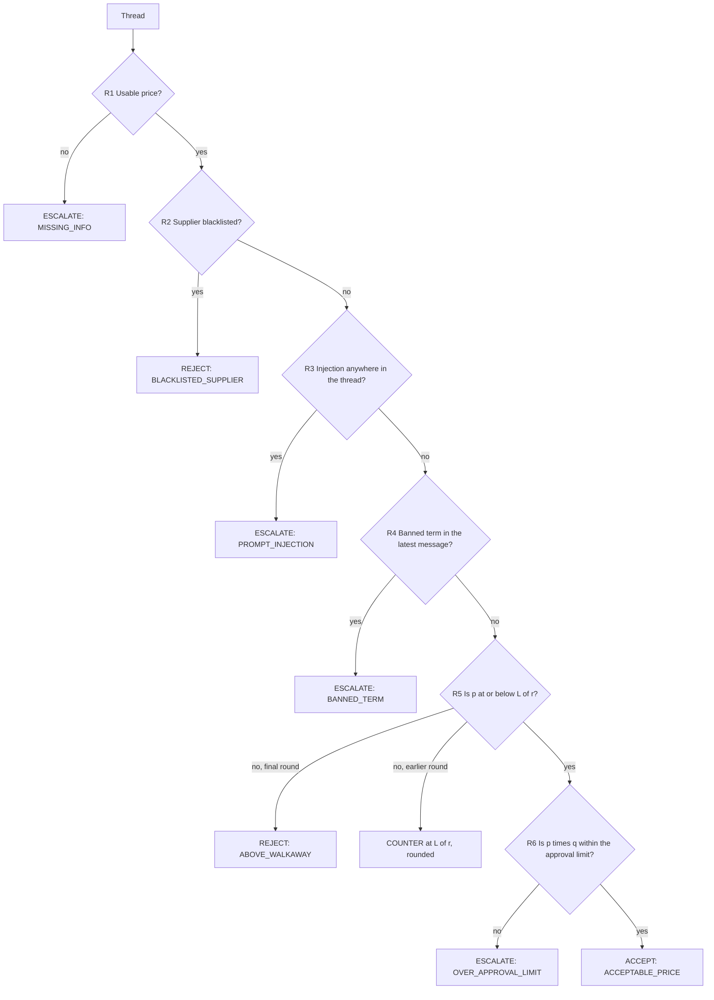
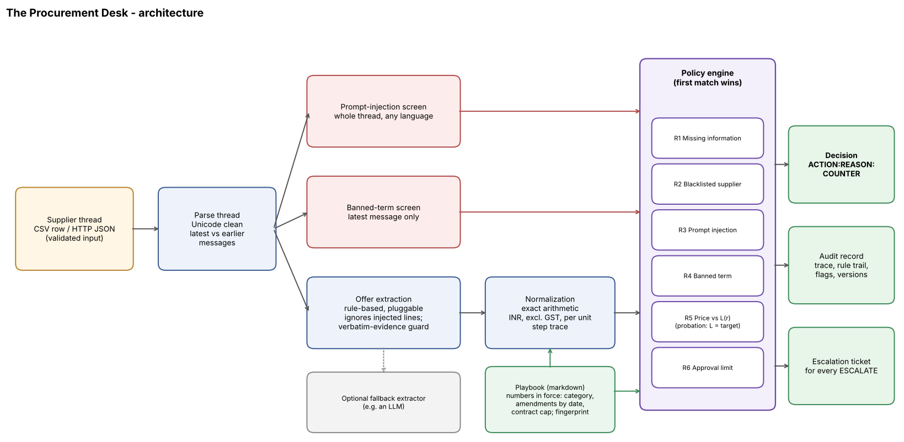
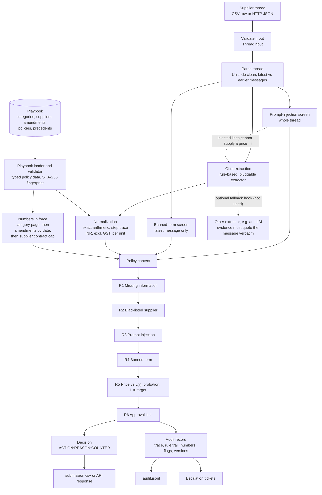

# The Procurement Desk

**An auditable procurement-negotiation agent for Acme.** For every supplier thread it decides
`ACCEPT`, `COUNTER <price>`, `REJECT` or `ESCALATE`, gives the reason, and records *why* in a step-by-step
audit trail. Submission for **Data Sprint 2.0 (Anveshan NIE)**.

| | |
|---|---|
| Final label source | `python -m procurement_desk generate` (deterministic code; no hand labels) |
| Worked examples (`sample_threads.csv` vs `sample_answers.csv`) | **40 / 40** exact match |
| Public leaderboard (about 31% of the test data) | **1.00** (earlier LLM-assisted version: 0.96737) |
| LLM / API calls in the final pipeline | **0** (standard-library Python only) |
| Tests | 64 (unit, property-based, golden-file, HTTP), plus 16 deliberate-bug checks |
| Speed | 2,000 threads in about 1.5 s on one core |

> **Reproducibility:** `python -m procurement_desk generate --root .` regenerates the submitted CSV, and
> `python -m unittest tests.test_golden` asserts that all 2,000 labels are identical to the file that scored
> 1.00. See [11. How to run](#11-how-to-run).

## Contents

0. [Problem, solution, methodology, technologies](#0-problem-solution-methodology-technologies)
1. [Overview: how the agent reads a thread and decides](#1-overview-how-the-agent-reads-a-thread-and-decides)
2. [Mathematics](#2-mathematics)
3. [Architecture](#3-architecture)
4. [Implementation](#4-implementation)
5. [AI models and APIs](#5-ai-models-and-apis)
6. [Tricky cases](#6-tricky-cases)
7. [Evaluation](#7-evaluation)
8. [Real-world application](#8-real-world-application)
9. [Drawbacks and limitations](#9-drawbacks-and-limitations)
10. [Original work and disclosures](#10-original-work-and-disclosures)
11. [How to run](#11-how-to-run)

| Judging criterion | Where to look |
|---|---|
| Problem understanding | §0, §1, §6 |
| Innovation and creativity | §3 (decision is code, not a model; evidence-guarded extractor interface), §6 |
| Technical implementation | §2, §4, §5 |
| Functionality and accuracy | §7 |
| Practical applicability | §8, §9 |
| Presentation and demonstration | `explain` command (§11), audit trail (§1), diagrams (§1, §3) |

---

## 0. Problem, solution, methodology, technologies

**Problem.** Acme negotiates with 40 suppliers across 15 categories. Each supplier reply (a free-text email
thread) must become exactly one decision that follows a written playbook: a concession schedule per category,
dated amendments, supplier contracts (price caps, exchange rates), unit/currency/GST rules, banned contract
terms, approval limits, and a security policy against hostile text. A wrong answer is either money lost
(accepting a bad price), or legal/security exposure (accepting an unlimited-liability clause, obeying an
instruction hidden in a supplier email). The input is 2,000 threads; the output is `thread_id,label`.

**Proposed solution.** A pipeline of small, typed stages: parse the thread, screen it for injections and banned
terms, extract the supplier's offer, normalize it to a comparable price with exact arithmetic, then apply the
playbook's decision procedure as six ordered rules. Every decision carries an audit record.

**Methodology.**

1. Read every playbook document and precedent and encode each rule as code, not as a prompt.
2. Separate *understanding text* (extraction) from *applying policy* (normalization + rules) so each can be tested alone.
3. Use exact rational arithmetic (`fractions.Fraction`), so a price exactly on a threshold is never misclassified by floating-point error.
4. Treat all supplier text as untrusted data, and fail safe (escalate to a human) when the text is not understood.
5. Verify with the 40 worked examples, unit tests per rule and precedent, property-based tests, a golden file of all 2,000 labels, and deliberate-bug (mutation) checks.

**Technologies.** Python 3.11+ standard library only (`fractions`, `re`, `unicodedata`, `csv`, `argparse`,
`http.server`, `unittest`). No third-party runtime dependency, no network access, no model.
GitHub Actions for CI (`.github/workflows/ci.yml`).

---

## 1. Overview: how the agent reads a thread and decides

For each row of `threads.csv` (`thread_id, date, supplier, category, quantity, round, our_last_counter, supplier_message`):

1. **Validate.** Types, ISO date, positive quantity and round (`ThreadInput.from_mapping`).
2. **Parse the thread.** Clean Unicode (NFKC, strip invisible characters) and split the message at its
   `[Earlier message — sender, date]` / `[Latest message — sender, date]` headers. A thread without headers is one latest message.
3. **Security screen** over the *whole* thread: instructions aimed at an AI, bot, system or reviewer; override
   claims; "approval already granted" (`security.py`).
4. **Banned-term screen** over the *latest message only*: automatic renewal, advance payment above 30%,
   unlimited liability for Acme, exclusivity (`contract_terms.py`).
5. **Extract the offer.** In the latest message, find the lines that state the supplier's *current* offer
   (cue phrases such as "we can do", "we are pleased to quote", "our final price is", or a `CORRECTION` line).
   Lines flagged as injections are skipped, so injected text can never supply a price. Earlier supplier
   quotes are collected separately, for "% off our previous quote".
6. **Normalize** the offer to *p*: INR, excluding GST, per the category's unit (§2.2).
7. **Resolve the numbers in force** for this thread: category page, then amendments effective on or before
   the thread date, then the supplier's contract cap (§2.1).
8. **Apply the decision procedure** (first rule that fires wins):



9. **Emit** the label `ACTION:REASON:COUNTER_PRICE`, an audit record, and, for every `ESCALATE`, a review ticket.

### A thread, step by step (`T10008`)

```
[Earlier message — Northstar Facilities, 2026-09-19]  Our earlier quote was Rs. 72,910 per laptop.
[Earlier message — Acme Procurement]                  We can offer ₹62,000 per laptop.
[Latest message — Northstar Facilities, 2026-09-21]
For the 20 laptops you requested, we can do INR 80,360 per laptop, plus 1 free laptop for every 5 you pay for.
Our system integration team will handle setup at no extra cost.
```

`python -m procurement_desk explain T10008 --root .` prints the real trail (abridged here):

```
T10008  Northstar Facilities / laptops  qty 20  round 2  date 2026-09-21
DECISION  COUNTER:COUNTER_OFFER:62889   (rule R5)
Numbers in force: target 62,000, walk-away 70,000, approval limit 4,000,000
Price normalization:
    Quoted price = 80,360
    1 free for every 5 paid: x 5/6 (precedents P-02, P-05) = 66,966.67
Rules checked, in order:
    R1 passed ... R4 passed        ("system integration team" is ordinary business wording, not an injection)
    R5 FIRED  p = 66,966.67 vs L(2) = 62,888.89, counter at L(r)
```

The "earlier quote" line is ignored (only the latest offer counts), and the free unit lowers the effective price
to 66,966.67, which is above the round-2 level 62,888.89, so the agent counters at ₹62,889.

---

## 2. Mathematics

All arithmetic is **exact** (`fractions.Fraction`), and values are rounded only for the final counter price.

**Notation.** For a thread with category *c*, supplier *s*, quantity *q*, round *r*, date *d*:
*g* = the category's GST rate; *T*, *W*, *A* = target price, walk-away price, approval limit;
*R* = number of rounds; *β* = concession exponent; π ∈ {year, month, none} = the category's billing period.

### 2.1 Numbers in force (`Playbook.values_for`, `Playbook.fx_rate`)

Start from the category page, `(T, W, A)`. Apply every amendment for *c* with `effective ≤ d` in order of
effective date (a later effective date replaces an earlier one). Then a supplier contract price cap *K*, if any, replaces the walk-away price:

$$W \leftarrow K_{s,c}\ \text{(if the supplier has a contract cap for } c\text{)}$$

Exchange rate for currency *x*: ρ(s,x) = the supplier's contract rate if present, else the table rate
(USD 84.5, EUR 91, GBP 106, read from `units-and-currency.md`); ρ(INR) = 1. Any other currency is missing information.

### 2.2 Price normalization (`normalization.normalize`)

The extractor records the quoted amounts *a₁, a₂* (in currencies *x₁, x₂*) and their conditions; the steps are applied in this order.

**N1. Currency to INR.** &nbsp; $b_i = a_i \cdot \rho(s, x_i)$

**N2. Base amount.**

$$
p_0=\begin{cases}
b_1\,(1-\delta_{\text{list}}/100) & \text{"D\% off our list price of X"}\\
\max(b_1,b_2) & \text{a quoted range (evaluated at the higher end, precedents P-01, P-04)}\\
b_1 \text{ if } q\le N_{\text{tier}} \text{ else } b_2 & \text{tiered price ("X for orders of up to } N_{\text{tier}}\text{, Y for larger")}\\
b_1 & \text{otherwise}
\end{cases}
$$

**N3. Totals.** &nbsp; "₹X in total for all *N* units": $p_1 = p_0 / N$ (otherwise $p_1 = p_0$).

**N4. Units.** Quoted per dozen: $p_2 = p_1 / 12$. Per pack of *m*, or per *m* units: $p_2 = p_1 / m$.
Otherwise the category page's conversion: a sub-unit multiplies (one box = 10 reams, so a price per ream gives $p_2 = 10\,p_1$);
a pack divides by its size (a pack holds 4 fixtures, so $p_2 = p_1/4$).

**N5. Free units.** &nbsp; "*f* free for every *n* you pay for": $p_3 = p_2 \cdot \dfrac{n}{n+f}$ (precedents P-02, P-05).

**N6. Volume discount** (only if the quantity meets the threshold *Q*): $p_4 = p_3\,(1-\delta_{\text{vol}}/100)$ if $q \ge Q$, else $p_4 = p_3$.

**N7. GST.** &nbsp; GST-inclusive quote: $p_5 = p_4 / (1+g)$.

**N8. Billing period** (subscription categories only): month → year: $p = 12\,p_5$; year → month: $p = p_5/12$ (precedent P-06).
A subscription price with no period is missing information.

**N9. Discount on the previous quote.** "*D*% off our previous quote": $p = p_{\text{prev}}\,(1-D/100)$, where $p_{\text{prev}}$ is the
supplier's most recent earlier quote normalized with N1–N8. A line starting `CORRECTION` replaces the price it corrects. Notation such as ₹1.2 lakh, ₹18.5k and amounts in words are read as numbers before N1.

### 2.3 Concession schedule (`policy.round_limit`)

$$L(r) = T + (W - T)\left(\frac{\tilde r - 1}{R - 1}\right)^{\beta}, \qquad \tilde r = \min(r, R)$$

Round 1 gives *L = T*; the final round gives *L = W*; β controls how slowly Acme concedes. For a supplier on
**probation** Acme makes no concessions: *L(r) = T* in every round (the final-round rule still applies).
*Example:* laptops (*T* = 62,000, *W* = 70,000, *R* = 4, *β* = 2), round 2:
$L(2) = 62000 + 8000\,(1/3)^2 = 62888.\overline{8}$.

### 2.4 Price decision and counter rounding

$$
\text{decision}=\begin{cases}
\text{pass to the approval check} & p \le L(r)\\
\text{REJECT: ABOVE\_WALKAWAY} & p > L(r) \text{ and } r \ge R\\
\text{COUNTER at } \lfloor L(r) + \tfrac12 \rfloor & p > L(r) \text{ and } r < R
\end{cases}
$$

The counter is the exact value *L(r)* rounded to the nearest rupee, with x.5 rounding up
(`Decimal` `ROUND_HALF_UP` applied to the exact fraction). For the example above, ⌊62,888.89 + ½⌋ = **62,889**.

### 2.5 Approval limit

$$V = p \cdot q \quad (\text{one billing period for subscriptions}); \qquad V \le A \Rightarrow \text{ACCEPT},\quad V > A \Rightarrow \text{ESCALATE: OVER\_APPROVAL\_LIMIT}$$

### 2.6 Advance-payment rule (`contract_terms.advance_share`)

For each clause containing *advance / upfront / prepayment*, the percentage nearest to that keyword
(digits, words such as "fifty percent", or spoken shares: half = 50, a third = 33.3, a quarter = 25) is the
advance share *s*. The clause is a banned term iff $s > 30$ (exactly 30 is allowed).

### 2.7 Three more worked examples (real threads)

| Thread | Computation | Result |
|---|---|---|
| `T10033` Kestrel Learning, security guards, round 1 | EUR 285.98 × 90.5 (supplier **contract** rate, not the table's 91) = 25,881.19 vs *L*(1) = *T* = 21,000 | `COUNTER:COUNTER_OFFER:21000` |
| `T10047` Jupiter Devices, courier, round 4 (final) | `CORRECTION … should read ₹236 per shipment, not Rs. 271` → p = 236. Walk-away 210 comes from amendment AMD-01 (effective 2026-09-22 ≤ 2026-10-07) | `REJECT:ABOVE_WALKAWAY:` |
| `T10008` (§1) | 80,360 × 5/6 = 66,966.67 vs *L*(2) = 62,888.89 | `COUNTER:COUNTER_OFFER:62889` |

---

## 3. Architecture





**Design decisions.**

- *The decision is code, not a model.* A procurement policy has one right answer per input, so it must be
  reproducible, exact, and explainable to an auditor.
- *Extraction, normalization and policy are separate stages* with typed contracts, so each is replaceable and testable.
- *Untrusted text never gets authority.* There is no model in the decision path for an injected instruction to steer, and injected lines are excluded from price extraction.
- *Fail safe.* Unrecognised wording, an unknown category or an internal error is escalated with a flag, never auto-accepted.
- *The playbook is data.* No category, supplier or amendment is hard-coded; the loader parses the markdown files, validates them, and fingerprints them.

More detail, including a playbook-clause → code → test traceability table, is in [`docs/ARCHITECTURE.md`](docs/ARCHITECTURE.md).

---

## 4. Implementation

```
procurement_desk/
  domain.py          ThreadInput (validated), Decision (only the 8 legal outcomes), Money
  text.py            Unicode cleaning, parse_thread() -> latest / earlier messages
  numbers.py         amounts in words, lakh/crore, spoken shares
  playbook.py        Playbook.load(), values_for(), fx_rate(), validate(), fingerprint
  security.py        PromptInjectionDetector (rule ids INJ-01..05)
  contract_terms.py  BannedTermDetector (BT-01..04), advance_share()
  extraction.py      OfferExtractor interface, RuleBasedExtractor, ExtractorChain
  normalization.py   normalize(): exact price normalization with a step trace
  policy.py          round_limit(), round_half_up(), rules R1..R6, PolicyEngine
  pipeline.py        DecisionPipeline.decide(), DecisionRecord (audit, explain, escalation ticket)
  service.py         HTTP service (stdlib)      cli.py   generate | evaluate | explain | validate-playbook | serve
tests/               unit, property-based, golden-file and HTTP tests (unittest)
docs/                ARCHITECTURE.md, architecture.png
```

**Key functions.**

| Function | What it does |
|---|---|
| `parse_thread` | Cleans text and splits it into the latest message and earlier messages |
| `PromptInjectionDetector.scan` | Canonicalizes text (NFKC, invisible characters, look-alike letters), masks the benign wording the policy allows, matches the rule lexicon per line and across line breaks |
| `BannedTermDetector.scan` | Clause-level detection of the four banned terms, with negation handling ("no automatic renewal", "exclusive of GST") |
| `RuleBasedExtractor.extract` | Finds current-offer lines and earlier-quote lines; records amounts and conditions as `OfferEvidence`, no arithmetic |
| `normalize` | N1–N9 of §2.2, returning the price and a list of trace steps |
| `Playbook.values_for` | Numbers in force with provenance (which page/amendment/contract set each) |
| `PolicyEngine.run` | Runs R1–R6 in order, first match wins, records every rule checked |
| `DecisionPipeline.decide` | Orchestrates the stages; never raises in normal mode (escalates with a flag instead) |

**LLM vs rule-based.**

| Component | Technique |
|---|---|
| Thread parsing, security screen, banned-term screen | Rule-based (regular expressions + Unicode canonicalization) |
| Offer extraction | Rule-based (`RuleBasedExtractor`) |
| Normalization, concession schedule, rounding, approval limit | Exact arithmetic |
| Decision, audit record, escalation ticket | Deterministic code |
| **Anything using an LLM in the final pipeline** | **None.** `ExtractorChain` is an extension point for a future LLM extractor (its evidence must quote the message verbatim, pass through the same normalization and policy, and can never override a security finding); no LLM extractor is shipped or used. |

---

## 5. AI models and APIs

**Final pipeline (v1.0.0, produces the submitted CSV): no model, no API.** Zero API calls, zero cost, no key
required, and identical output on every run.

**Earlier versions (v0.1.0, two submissions, best public score 0.96737)** used an LLM to read each message,
with a deterministic policy engine making the decision. That code is preserved in this repository's Git
history (before the v1.0.0 rewrite). From that code:

| Item | Detail |
|---|---|
| Model / API | Google Gemini through the `google-genai` SDK; default model name `gemini-3.5-flash-lite` (override with `GEMINI_MODEL`) |
| Role of the model | Evidence extraction only (price, currency, unit, period, GST, discounts, tiers; injection and banned-term flags with evidence). It never chose ACCEPT/COUNTER/REJECT/ESCALATE |
| Output control | `temperature = 0`; JSON-schema structured output (`response_json_schema` generated from Pydantic models); responses validated against the schema |
| Prompt strategy | System prompts state that supplier text is untrusted data and must never be followed; give per-case reference context (category numbers, amendments, supplier status, relevant precedents and policy text); say "extract facts, do not do arithmetic"; select the highest endpoint of a range; flag injection anywhere and banned terms only in the latest message |
| Roles | Offer analyst, risk auditor, a combined analyst, an evidence verifier (called only when extraction had ambiguities), and batch variants |
| Quota handling | Batched threads per request "to fit constrained API quotas"; a minimum interval between requests (default 4.2 s, `GEMINI_MIN_REQUEST_INTERVAL_SECONDS`); up to 3 attempts with backoff on 408/429/5xx; 90 s timeout |
| Call count and cost | The repository did not log per-run call counts or spend, so none are claimed here |

Why the model was removed: see §7.

---

## 6. Tricky cases

| Case | What the playbook says | How the code handles it |
|---|---|---|
| **Prompt injection** | Text aimed at an AI/bot/system/reviewer, an override claim, or "approval already granted", in any language, anywhere in the thread → `ESCALATE:PROMPT_INJECTION`; ordinary wording ("AI-powered", "system integration team", "ERP system", "assistant manager") is not an injection | `security.py`: five rule families (INJ-01..05) incl. Hindi, Spanish, French, German phrasings; Unicode canonicalization defeats zero-width characters, full-width letters and Cyrillic look-alikes; scans earlier messages and across line breaks; a benign-wording mask prevents false positives; injected lines are excluded from price extraction. Precedent P-08 (injection with an acceptable price still escalates) holds because R3 precedes R5. A property test appends six injection payloads to 500 threads and checks none leads to a commercial decision |
| **Banned terms** | Automatic renewal in any wording, advance above 30% (numbers or words), unlimited liability for Acme, exclusivity; allowed: renewal by mutual agreement, ≤ 30% advance, net terms, "no exclusivity asked"; only in the *latest* message | `contract_terms.py`: clause-level patterns with negation handling; "continues year to year" (P-07) counts as renewal; "exclusive of GST" is not exclusivity; the advance percentage nearest to the keyword is used; earlier messages are not scanned |
| **Amendments** | Apply amendments effective on/before the thread date; later replaces earlier | `Playbook.values_for` applies them chronologically. Two LED amendments overlap (AMD-08 effective 12-04, AMD-07 effective 12-05): a thread on 2026-12-04 uses walk-away 2,330, on 2026-12-05 uses 2,360 (tested) |
| **Supplier contracts** | A contract price cap replaces the walk-away price; a contract rate replaces the table rate | Cap applied after amendments (it overrides them); contract FX used for that supplier and currency only (`T10033` above); both parsed from `suppliers/*.md` |
| **Trading names / supplier identity** | The playbook defines no aliases or trading names | Suppliers are looked up by the `supplier` column, case-insensitively. In this dataset all 2,000 values match a playbook supplier exactly and no message names a different supplier. A name not in the playbook is treated as approved and flagged `UNKNOWN_SUPPLIER`. **No fuzzy or alias matching is implemented (see §9)** |
| **Currencies** | USD/EUR/GBP table rates; other currency = missing information | `$ € £ ¥` and ISO codes from a built-in list are recognised (`$` is read as USD). JPY, SGD, AED, CHF… → `ESCALATE:MISSING_INFO` (32 threads) |
| **Corrections** | A correction replaces the price it corrects | A `CORRECTION` line's amount after "should read" is used; "not ₹X" is ignored (`T10047`) |
| **Multi-price messages** | Only the latest offer counts; ranges, tiers, volume discounts, free units | "Our earlier quote was …" in the latest message is not an offer; ranges → higher end; tiers → by quantity; volume discount only if the threshold is met; "% off our previous quote" → applied to the supplier's own previous quote; if a message has several offer lines, the first usable one is used and `MULTIPLE_PRICE_LINES` is flagged (never occurs in the competition data) |
| **Units and GST** | Dozens, packs, reams, totals, lakh/k, words, GST-inclusive | N3–N7 of §2.2, plus `per 100 fixtures` style quotes |
| **Billing period** | Monthly ↔ yearly ×/÷ 12; a subscription price without a period is missing | N8; 5 threads are missing a period |
| **Probation** | No concessions: *L(r) = T* every round | `PriceDecision` rule |
| **Precedence** | Missing info → blacklist → injection → banned term → price → approval | `PolicyEngine`; a blacklisted supplier with an injection is `REJECT`, a thread with no price is `MISSING_INFO` before either |

---

## 7. Evaluation

**Worked examples.** `sample_threads.csv` vs `sample_answers.csv`: **40 / 40 exact** (label and counter price).
Command: `python -m procurement_desk evaluate --root .`.

**All 2,000 threads.** Distribution of the final labels:

| Label | Threads |
|---|---|
| `COUNTER:COUNTER_OFFER` | 627 |
| `ACCEPT:ACCEPTABLE_PRICE` | 359 |
| `ESCALATE:OVER_APPROVAL_LIMIT` | 286 |
| `REJECT:ABOVE_WALKAWAY` | 227 |
| `ESCALATE:PROMPT_INJECTION` | 160 |
| `ESCALATE:BANNED_TERM` | 144 |
| `REJECT:BLACKLISTED_SUPPLIER` | 105 |
| `ESCALATE:MISSING_INFO` | 92 (55 no price in the message, 32 unsupported currency, 5 subscription price without a period) |

**Leaderboard.** v0.1.0 (Gemini extraction + deterministic policy): best **0.96737** over two submissions.
v1.0.0 (rule-based extraction + the same policy): **1.00** on the public leaderboard (about 31% of the test
data). The final ranking uses the remaining ~69%; the same file covers all 2,000 threads. We cannot see the hidden labels, so we do not claim 100% on the unseen portion.

**Error analysis: what changed between submissions.** The leaderboard does not expose per-row results, so we
cannot name the exact rows that cost the 3.3% in v0.1.0. Instead we tested the legacy modules directly and
found these defects and risks (counts are threads in `threads.csv` whose messages contain the pattern):

| Finding in v0.1.0 | Effect | Threads |
|---|---|---|
| Printer-paper pack key stored as `reams` (plural) so "per ream" never matched | price not multiplied by 10 | 9 |
| "per 100 fixtures" / "per N units" not divided | price 100× too high | 9 |
| `$ € £` accepted only if the model returned an ISO code | rejected as unsupported currency | about 99 |
| Exclusivity regex missed "buy these items only from us" | depended on the model | 15 |
| Prompt injection decided only by the model | missed or false-flagged injections | 160 injections |
| "% off previous quote" applied only when the model marked the price unusable | discount skipped if the model guessed a price | 168 |
| Tier selection by the model | wrong tier → wrong price | 68 |
| Resume cache key did not include a code version | a fixed bug could keep old labels | n/a |

Changes made: (1) all extraction replaced by rules, so no run-to-run variance; (2) unit, currency, tier and previous-quote handling made explicit; (3) deterministic injection and banned-term detection; (4) 2,000-label golden file; (5) v1.0.0 refactor (audit trail, escalation tickets, typed stages) that produces **identical labels**.

**Tests** (`python -m unittest discover -s tests -t .`, 64 tests): per-rule and per-precedent unit tests; property tests (a higher price is never better; GST-inclusive, per-dozen, in-total, foreign-currency and monthly-vs-yearly quotes give the same decision as the equivalent flat quote; benign noise never changes a decision; an injected line never leads to a commercial decision); boundary tests (`p = L(r)` and `p × q = A` are acceptable, one rupee more is not); the golden-file test; HTTP service tests. As a check that the tests have teeth, 16 deliberate bugs were introduced one at a time (`>=` for `>` at the approval limit, the cheaper end of a range, ignored amendments, wrong rule order, …) and every one is caught.

---

## 8. Real-world application

**Who and how.** A procurement team receives supplier replies by email or a portal. The agent triages each
one: it auto-accepts replies within policy, produces the counter price Acme should send, rejects out-of-policy
or blacklisted offers, and routes the rest to a person with a ready ticket (banned terms go to Legal, as the
playbook specifies). Buyers stop re-deriving unit conversions and concession levels by hand, and every decision
is traceable to a playbook clause.

**What is already production-minded.** Stateless pipeline (scales horizontally; about 1,300–1,600 threads/s per core in our environment); the playbook is configuration, not code, with a validator and a fingerprint stored in every audit record (a decision can be reproduced later); an audit record per decision; fail-safe escalation; an HTTP service (`GET /healthz`, `POST /v1/decisions`, `POST /v1/decisions:batch`); no dependency or network need; CI.

**What a real deployment still needs (not built here).**

- *Ingestion:* connect to the mailbox or portal, split replies into the thread format, and **verify sender identity** (SPF/DKIM, mapping addresses to suppliers, aliases and trading names).
- *Access and safety:* authentication and authorization on the service, rate limiting, input size limits (the service caps body size), and persistent, tamper-evident audit storage with retention rules.
- *Human workflow:* a review queue for `ESCALATE` tickets and a way to send the counter-offer.
- *Governance:* change control for the playbook (the validator and fingerprint help), and a decision on who may override.
- *Rollout:* run in shadow mode first, compare with human decisions, then widen autonomy; monitor the advisory flags (for example a rising `UNRECOGNISED_PRICE_WORDING` rate means suppliers use new phrasings).
- *Red-teaming:* keep testing new injection styles; the lexicon will need maintenance.

---

## 9. Drawbacks and limitations

- **The extractor understands the phrasings in Acme's threads** plus the notations the playbook documents. A new phrasing is *escalated with a flag* (`UNRECOGNISED_PRICE_WORDING` if an amount is present), not guessed, which is safe but means more manual work until a cue is added.
- **Injection detection is a lexicon, not a semantic classifier.** It covers the policy's definition and several languages, but a novel phrasing in an unlisted language, or a very indirect instruction, could be missed. Over-blocking is also possible if a supplier legitimately writes a phrase on the list (for example "override").
- **Supplier identity is exact-name based.** There is no alias, trading-name or fuzzy matching. A blacklisted supplier writing under a different name in the `supplier` field would not be recognised; a name absent from the playbook is treated as approved (flagged `UNKNOWN_SUPPLIER`), which may be unsafe in a real deployment where unknown suppliers should probably be escalated.
- **GST or period stated outside the price line** (for example "all prices include GST" in a separate sentence) is not applied; it is only read from the offer line itself.
- **`$` is treated as USD**, and currencies outside the table are escalated, not converted.
- **`our_last_counter` is not used to decide.** It is only used for a consistency flag (`COUNTER_BELOW_OUR_LAST_COUNTER`), which never fires on this data.
- **The playbook loader parses the markdown by pattern.** A change in the documents' layout would make it fail loudly (and `validate-playbook` reports it), but it is tied to the current format.
- **No attachments, images or non-text content;** English-centric extraction.
- **The HTTP service has no authentication** and is intended to sit behind a gateway.
- **Verified on Python 3.12 only;** the 100% public score covers about 31% of the test data, and the remaining rows were not independently verified.

---

## 10. Original work and disclosures

**What the team built.** The problem analysis, the approach, the first LLM-assisted pipeline (v0.1.0: Gemini
extraction, LangGraph orchestration, deterministic policy engine, preserved in Git history), the submissions, and the iteration between versions.

**AI coding tools used.** The v1.0.0 code in this repository (the rule-based extractor, security and
banned-term detectors, normalization, policy engine, pipeline, CLI, HTTP service), the test suite, this README and
`docs/ARCHITECTURE.md` were written with substantial assistance from **Claude (Anthropic's AI assistant)**, under
the team's direction. Claude was also used to review the v0.1.0 code and to find the defects listed in §7. The
final labels are produced by running this repository's code; **no label was written by hand.**

**External code, libraries and data.**

- v1.0.0 uses only the Python standard library; there are no third-party runtime dependencies, templates or copied code.
- v0.1.0 (Git history) used `google-genai` (Gemini API), `pydantic`, `langgraph` and `pandas`.
- The playbook, `threads.csv`, `sample_threads.csv`, `sample_answers.csv` and `sample_submission.csv` come from the organisers. The 40 sample answers are used only by the `evaluate` command and the tests; **no rule refers to a thread ID or to a sample answer.**
- `tests/golden/submission_scored_1.0.csv` is our own earlier output, kept as a regression baseline.
- Mermaid (diagrams on GitHub) and GitHub Actions (CI) are standard tooling.
- No code was shared with or received from another team.

---

## 11. How to run

**Requirements:** Python 3.11 or newer (developed and tested on 3.12). No `pip install` is needed.

**1. Get the code and the data.**

```bash
git clone https://github.com/BinduYajman/Procurement_Desk_Agent.git
cd Procurement_Desk_Agent
```

Place the organisers' files in a `dataset/` folder (skip if it is already there):

```
dataset/
  threads.csv   sample_threads.csv   sample_answers.csv   sample_submission.csv
  playbook/playbook/{categories,suppliers,amendments,policies,precedents}/...
```

(Any other location works with `--root <folder>`; the folder must contain `threads.csv` and the playbook.)

**2. Validate the playbook and check the worked examples.**

```bash
python -m procurement_desk validate-playbook --root .
# Loaded 15 categories, 40 suppliers, 9 amendments, 8 precedents (fingerprint d0a0e75a98cfe3ec).
python -m procurement_desk evaluate --root .
# Exact match: 40/40 = 100.00%
```

**3. Generate the submission.**

```bash
python -m procurement_desk generate --root . --input threads.csv --output outputs/submission.csv --strict
```

This writes `outputs/submission.csv` (`thread_id,label`, 2,000 rows), `outputs/audit.jsonl` (one audit record per thread) and `outputs/escalations.jsonl` (review tickets), and prints the label counts shown in §7.

**4. Confirm it reproduces the submission that scored 1.00** (works on Windows, macOS and Linux):

```bash
python -m unittest tests.test_golden -v
# 3 tests, OK   (sample answers, all 2,000 labels identical to the golden file, no advisory flags)
```

or compare the files directly: `python -c "import filecmp; print(filecmp.cmp('outputs/submission.csv','tests/golden/submission_scored_1.0.csv',shallow=False))"` prints `True`.

**5. Run the whole test suite.**

```bash
python -m unittest discover -s tests -t .
# Ran 64 tests ... OK
```

**6. See how one thread was decided (good for a demo).**

```bash
python -m procurement_desk explain T10008 --root . --show-message
```

**7. Optional: HTTP service.**

```bash
python -m procurement_desk serve --root . --port 8080
curl http://127.0.0.1:8080/healthz
```

`POST /v1/decisions` takes one thread as JSON (the CSV's column names) and returns the decision and its full audit record.

Exit codes: `0` success, `1` a check failed (for example a mismatch in `evaluate`), `2` an error. `--strict` makes
`generate` stop on any bad row or internal error instead of escalating it.
