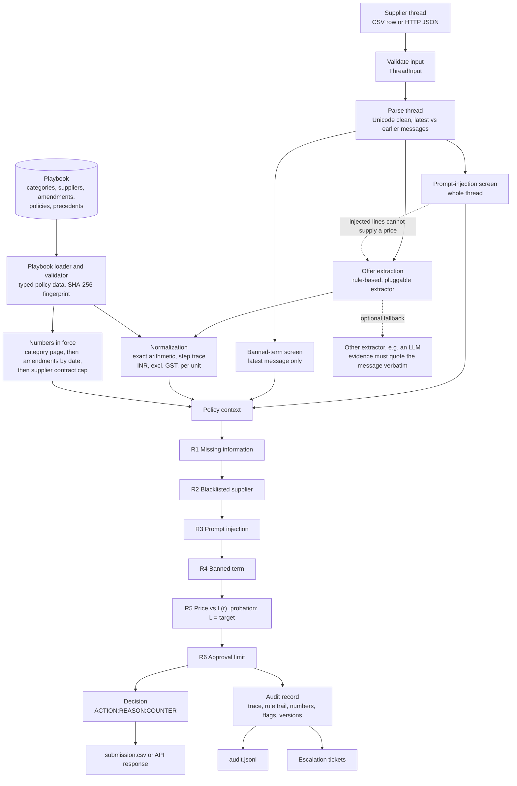

# Architecture

## 1. The problem

Acme negotiates with 40 suppliers across 15 categories. Each supplier reply must become one decision
(`ACCEPT`, `COUNTER`, `REJECT`, `ESCALATE`) that follows a written playbook exactly: a concession schedule,
dated amendments, supplier contracts, unit and currency rules, banned contract terms, and a security policy
for hostile text. A wrong answer is either money lost (accepting a bad price) or a legal and security
exposure (accepting a banned term, obeying an injected instruction).

## 2. Design principles

1. **The decision is code, not a model.** A procurement policy has one right answer per input. It must be
   reproducible, exact, and explainable to an auditor, so it is implemented as deterministic code with exact
   arithmetic.
2. **Understanding text and applying policy are separate stages.** Extraction records *what the supplier
   said*; normalization turns that into a price; the policy engine decides. Each stage has a typed contract,
   so any stage can be replaced or extended without touching the others.
3. **Untrusted input never gets authority.** Supplier text is only ever data. Injected lines are detected
   and can never supply a price. There is no model in the decision path to be steered.
4. **Fail safe, never guess.** An unrecognised message, an unknown category, or an internal error produces an
   escalation to a human with a flag explaining why. It never produces an automatic ACCEPT. Precision is
   preferred over recall in extraction: it is cheaper for a person to read one extra ticket than to act on a
   wrongly read price.
5. **Everything is explainable.** Each decision records the arithmetic, the numbers in force and where they
   came from, every rule checked, and the playbook version.
6. **Policy lives in the playbook.** No category, supplier or amendment is hard-coded.

## 3. Pipeline

## 4. Modules

| Module | Responsibility |
|---|---|
| `domain.py` | `ThreadInput` (validated), `Decision` (only the playbook's eight outcomes are constructible), `Money` |
| `playbook.py` | Parses the markdown playbook into typed data; resolves the numbers in force with provenance; validates the playbook; fingerprints it |
| `text.py` | Unicode cleaning (NFKC, invisible characters, look-alikes) and splitting a thread into latest and earlier messages |
| `security.py` | Layered prompt-injection detection with rule ids and a mask for the benign wording the policy allows |
| `contract_terms.py` | Banned-term detection (auto-renewal, advance above 30%, unlimited liability, exclusivity), with negation handling |
| `extraction.py` | `OfferExtractor` interface, the rule-based extractor, and `ExtractorChain` with a verbatim-evidence guard |
| `normalization.py` | Exact conversion of evidence to a comparable price, recording every step |
| `policy.py` | The decision procedure as six ordered rules plus the concession schedule |
| `pipeline.py` | Orchestration, fail-safe handling, `DecisionRecord` (audit, explanation, escalation ticket) |
| `service.py`, `cli.py` | Thin adapters: HTTP service and command line. No business logic |

## 5. Traceability: playbook clause, code, test

| Playbook clause | Implemented in | Verified by |
|---|---|---|
| Decision procedure, steps 1 to 6 in order; first match wins | `policy.py` (`R1` to `R6`, `PolicyEngine`) | `test_order_missing_beats_blacklist_beats_injection_beats_terms_beats_price`; mutation check on rule order |
| Missing information: no number, subscription without period, unlisted currency | `normalization.py`, `MissingInformation` | `test_currencies`, `test_billing_period`, `test_only_the_latest_offer_counts_and_stale_quotes_are_ignored` |
| Blacklisted supplier | `BlacklistedSupplier` | `test_basic_outcomes`, order test |
| Prompt injection anywhere in the thread, any language | `security.py`, `PromptInjection` | `test_policy_examples_are_caught`, `test_other_languages`, `test_evasion_attempts`, `test_in_an_earlier_message_counts`, property test on 500 threads |
| Benign wording is not injection (AI-powered, system integration, ERP, assistant titles) | `security.py` benign mask | `test_ordinary_business_wording_is_not_an_injection` |
| Banned terms in the latest message only | `contract_terms.py`, `BannedTerm` | `test_each_banned_term_in_any_wording`, `test_banned_terms_only_count_in_the_latest_message` |
| Advance payment above 30%, in numbers or words | `advance_share` | `test_advance_payment_threshold_numbers_and_words`, boundary at exactly 30% |
| Allowed wording (no renewal, 30% or less, net terms, no exclusivity) | negation patterns | `test_allowed_wording_is_not_flagged` |
| Concession schedule L(r), exact; final round = walk-away | `round_limit` | `test_schedule_endpoints_and_exactness` |
| Counter at L(r) rounded to the nearest rupee, x.5 up | `round_half_up` | `test_round_half_up`, mutation check |
| Final-round rule: above L(r) on round R is REJECT | `PriceDecision` | `test_basic_outcomes`, mutation check |
| Probation: L(r) = target in every round, final-round rule still applies | `PriceDecision` | `test_probation_makes_no_concessions_in_any_round` |
| Approval limit: p x quantity at or below the limit is acceptable | `ApprovalLimit` | `test_boundaries_are_inclusive`, mutation check |
| Numbers in force: category, then amendments by effective date, then contract cap | `Playbook.values_for` | `test_amendments_by_date_and_contract_cap`, `test_amendment_dates_change_the_decision` |
| Contract exchange rate replaces the table rate | `Playbook.fx_rate` | `test_contract_exchange_rate_replaces_table`, `test_currency_conversion_uses_contract_rates_only_for_that_supplier` |
| GST-inclusive prices, totals, list-price discounts, tiers, volume discounts | `normalization.py` | `test_gst_totals_and_list_price_discounts`, `test_ranges_tiers_free_units_volume` |
| Packs, dozens, "per N units", reams | `normalization.py`, `Category.sub_units` / `pack_size` | `test_per_ream_is_times_ten`, `test_per_n_units_and_packs_and_dozens` |
| Notation: lakh, k, amounts in words | `extraction.parse_amounts` | `test_notation_lakh_k_and_words` |
| Latest offer only; a correction replaces the price; "% off previous quote" | `extraction.py`, `normalization.py` | `test_previous_quote_and_correction` |
| Precedents P-01, P-04 (range at the higher end) | `normalization.py` | `test_ranges_tiers_free_units_volume` |
| Precedents P-02, P-05 (free units) | `normalization.py` | same test |
| Precedent P-03 (contract rate on a USD quote) | `Playbook.fx_rate` | `test_currencies` |
| Precedent P-06 (monthly to yearly) | `normalization.py` | `test_billing_period` |
| Precedent P-07 ("year to year" is auto-renewal) | `contract_terms.py` | `test_each_banned_term_in_any_wording` |
| Precedent P-08 (injection with an acceptable price still escalates) | `PromptInjection` rule order | `test_injection_with_acceptable_price_still_escalates` |
| Output format `ACTION:REASON:COUNTER` | `Decision` | `test_every_output_is_a_valid_label` |

Beyond the clauses: 40 of 40 labelled samples match, and the full 2,000-thread run is identical to the
submission that scored 1.00 (`tests/test_golden.py`). Property tests assert invariants for generated inputs:
a higher price is never better, equivalent ways of quoting (GST-inclusive, per dozen, in total, a foreign
currency, monthly versus yearly) give the same decision, benign noise never changes a decision, and an
injected line never leads to a commercial decision. To check that the tests have teeth, 16 deliberate bugs
(for example `>=` for `>` at the approval limit, the cheaper end of a range, ignored amendments) were
introduced one at a time; every one is caught.

## 6. Failure modes and safeguards

| Situation | Behaviour |
|---|---|
| Message wording the extractor does not recognise | `ESCALATE:MISSING_INFO` plus an `UNRECOGNISED_PRICE_WORDING` flag if an amount is present, so a person knows a price may exist |
| Two price lines in one message | First usable line is used; `MULTIPLE_PRICE_LINES` flag |
| Unknown category or internal error | `ESCALATE:MISSING_INFO`, `INTERNAL_ERROR` flag, error recorded. `--strict` raises instead |
| Malformed input row | Escalated with `INVALID_INPUT`; the HTTP service returns 400 |
| Supplier not in the playbook | Treated as approved, flagged `UNKNOWN_SUPPLIER` |
| Round above the category's final round | Treated as the final round, flagged |
| Counter below Acme's last counter | Flagged `COUNTER_BELOW_OUR_LAST_COUNTER` (a consistency check, never fires on the competition data) |
| Obfuscated injection (zero-width characters, look-alike letters, full-width text, split lines) | Detected after Unicode canonicalization |
| Text trying to supply a price from an injected line | Injected lines are excluded from extraction |
| Playbook edited inconsistently | `validate-playbook` fails (walk-away below target, conflicting amendments, unknown categories) |

## 7. Production path

- **Stateless and horizontally scalable.** The pipeline holds only the immutable playbook. Run it in a
  batch job, behind the included HTTP service, or in-process as a library. Throughput on one core in the
  sandbox is about 1,600 threads per second.
- **Playbook as configuration.** A playbook change needs no deploy. The fingerprint in every audit record
  identifies exactly which playbook version produced a decision, so decisions are reproducible later.
- **Audit and review.** `audit.jsonl` is the system of record. `escalations.jsonl` is a ready work queue.
  The only owner named by the playbook is Legal (banned terms); the other suggested owners are
  configuration in `pipeline.DEFAULT_ESCALATION_OWNERS`.
- **Using an LLM, if one is ever wanted.** Real-world messages are less regular than these. The extractor
  interface lets a language model read free-form wording behind `ExtractorChain`, with three guards that
  are already implemented and tested: its evidence must quote the message verbatim, it passes through the
  same normalization and policy as everything else, and it can never override a security finding. The
  decision itself stays in deterministic code.
- **Not built, deliberately.** Authentication, rate limiting and a persistent queue belong to the platform
  the service is deployed into. The service is a thin adapter so it can be swapped for FastAPI or a message
  consumer without touching the engine.

## 8. Known limits

- The rule-based extractor understands the phrasings in Acme's threads, plus the notations the playbook
  documents. New phrasings are escalated and flagged, not guessed. Adding one means adding a cue and a test.
- Injection detection is a lexicon with Unicode canonicalization, not a semantic classifier. It covers the
  playbook's definition and several languages; a novel phrasing in an unlisted language would not be caught.
- Verified on Python 3.12 only.

## 9. Design history

The first version used an LLM to read each message and a rules engine to decide. It scored 0.967 on the
public leaderboard. Reading the messages with deterministic rules removed the extraction errors and scored
1.00, while keeping the same decision logic. The earlier pipeline is available in the repository history.
